# Lumitrace

Lumitrace turns a spoken day into one Markdown file you own. You record from an iPhone or a
browser. A small server transcribes it, writes the day's page, and keeps the audio. You read
and edit that page in Obsidian. Any AI app that speaks [MCP](https://modelcontextprotocol.io)
can search it and answer with the dates it used.

Your journal stays in your storage. This repository holds the program, not your days.

> A **Flash** captures the moment, the **Prism** splits it into its colors, each day becomes a
> **Frame**, the **Spectrum** lays everything out in order, and the **Lens** lets you zoom into
> any day.



| | What it does | Where you see it |
|---|---|---|
| **Flash** | The capture clients. The web app the Prism serves at `/flash/` (sign in, add it to the iPhone Home Screen) and the iPhone Shortcuts. | Capture tab. Shortcuts are built on the phone (`docs/flash.md`). |
| **Prism** | The recording API and pipeline. It takes the voice, photos and notes, transcribes them, and writes the day. | Generate, beside a day in History, writes that day now. Otherwise the write waits until 4:05 a.m. |
| **Frames** | One Markdown file per day, plus the audio and photos beside it. This is the source of truth. The search index can be thrown away and rebuilt. | "This week" counts the files. Open the folder in Obsidian. |
| **Spectrum** | Watches the Frames and builds a SQLite index by words and by meaning. | Runs on the server. |
| **Lens** | The MCP server AI apps connect to. Tools: `search`, `get_day`, `query_facts`, `on_this_day`, `feedback`. Answers come only from your entries, with dates. | Claude, ChatGPT, or Cursor. |

Code: Flash web app in `lumitrace/prism/web/`, Prism in `lumitrace/prism/`, Frames in
`lumitrace/frames/`, Spectrum in `lumitrace/spectrum/`, Lens in `lumitrace/lens/`. One Python
package, one Docker image, three commands: `lumitrace-prism`, `lumitrace-spectrum`,
`lumitrace-lens`.

## How a day moves through

1. **Capture.** Flash sends audio to `POST /recordings`, or a photo with no recording to
   `POST /notes`. You pick the filing date first, including today. Anything before 4 a.m. local
   time belongs to the previous day.
2. **Keep the original.** Prism stores the audio and resized photos next to the day file and
   appends the transcript. Your later edits to the page are not overwritten.
3. **Write the page.** The first write fills a Format 6 day: a timeline, who and where, food,
   health, and the other family trackers. A later recording updates that page and keeps sentences
   you changed. Prompts live in `prompts/`.
4. **Index.** Spectrum reads the Markdown and updates SQLite. The Lens answers from that index.

Day file layout: `docs/frames-format.md`. How the programs share contracts: `docs/architecture.md`.

## Get started

You need Python 3.12. [uv](https://docs.astral.sh/uv/) installs the locked dependencies.
Docker is the other way to run it. Everything below can stay offline: the tests use fake speech,
fake models, and a folder on disk instead of Google Drive.

```bash
uv sync
cp .env.example .env
```

In `.env`, set `LUMITRACE_API_TOKEN` (`openssl rand -hex 32`) and `LUMITRACE_MCP_OWNER_PASSWORD`
(at least 16 characters). `change-me` makes the Prism refuse requests and the Lens refuse to
start. For a first look with no API keys:

```bash
# in .env
LUMITRACE_STT_PROVIDER=fake
LUMITRACE_LLM_WRITE_JOURNAL_MODEL=fake
LUMITRACE_LLM_FALLBACK_MODEL=fake
LUMITRACE_EMBEDDING_MODEL=fake
```

Then:

```bash
uv run pytest          # offline
uv run lumitrace-prism # http://localhost:8000/health  and  /flash/
```

Open `http://localhost:8000/flash/`, sign in with `LUMITRACE_FLASH_USERNAME` and
`LUMITRACE_FLASH_PASSWORD` (at least 10 characters), and record. Day files land in
`data/Lumitrace/`. Copy `docs/templates/family.example.md` to `secrets/family.md` when you want
the model to know who is who. That file is gitignored.

A note without the browser:

```bash
curl -H "Authorization: Bearer $TOKEN" -H 'Content-Type: application/json' \
  -d '{"text": "Fish tacos for lunch."}' localhost:8000/notes
```

Start Spectrum and the Lens when you want search: `uv run lumitrace-spectrum` and
`uv run lumitrace-lens`. The first-run checklist is in `docs/runbook.md`.

## Speech and model options

Providers are settings, not code changes (`lumitrace/config.py`). Chat and embedding models are
[LiteLLM](https://docs.litellm.ai/) model strings, so `gemini/...`, `openai/...`,
`anthropic/...`, `bedrock/...`, or a local `ollama/...` all use the same call. Put the provider
key in `.env` under the name that provider expects (`GEMINI_API_KEY`, `OPENAI_API_KEY`, ...).
Those lines are blank in `.env.example`.

| Job | Setting | What to set |
|---|---|---|
| Speech to text | `LUMITRACE_STT_PROVIDER` | `fake` (offline), `litellm` (OpenAI, Groq, Azure, ... via `LUMITRACE_STT_MODEL`), `sarvam` (Indian languages mixed with English; `LUMITRACE_SARVAM_API_KEY`, model `saaras:v4`, mode `codemix`), or `aws_transcribe` (needs `LUMITRACE_AWS_TRANSCRIBE_BUCKET`) |
| Write and update the day | `LUMITRACE_LLM_WRITE_JOURNAL_MODEL` | Default `gemini/gemini-3.8-flash`. Any LiteLLM chat model. `fake` writes a stand-in page for tests. |
| Fallback | `LUMITRACE_LLM_FALLBACK_MODEL` | Used when the first model fails or returns bad JSON. Default `gemini/gemini-3.6-flash`, same `GEMINI_API_KEY`. |
| Search vectors | `LUMITRACE_EMBEDDING_MODEL` | Default `gemini/gemini-embedding-2` at 1536 dimensions. Spectrum and the Lens must use the same model. Changing it rebuilds the index. `fake` is for tests. |

The shipped defaults assume a Gemini key and, for Telugu–English recordings, a Sarvam key.
Set every model to `fake` when you only want to try the app.

## Deployment

Three ways to run the same image. Ports: Prism `8000`, Spectrum `8001` (keep it internal; `/nudge`
has no auth), Lens `8002` (`/mcp`).

**On your computer.** The commands in Get started. Storage defaults to the `local` backend
(`data/Lumitrace`).

**Docker Compose.** From the repo:

```bash
docker compose up -d --build
```

That starts Prism, Spectrum, and Lens with a shared data volume. Delete the path settings that
the image already sets (`LUMITRACE_PROMPTS_DIR`, `LUMITRACE_LOCAL_ROOT`, `LUMITRACE_INDEX_PATH`,
and the two `LUMITRACE_GDRIVE_*_FILE` lines) from a `.env` you use with Docker, or they point at
folders that do not exist in the container.

**Google Drive instead of a local folder.** Create a Google Cloud OAuth client (Desktop app)
with the Drive API, save it as `secrets/gdrive_client_secret.json`, set
`LUMITRACE_STORAGE_BACKEND=gdrive`, and run `uv run lumitrace-drive-login` once. The scope is
`drive.file`: Lumitrace only sees files it created, in a `Lumitrace` folder. Renewal steps are
in `docs/runbook.md`.

**A server on AWS Lightsail, reached through Tailscale.** `deploy/lightsail/` is the path used
for a single small Ubuntu box. It does not contain an account id, an IP, or keys.

1. Sign in with the AWS CLI (`deploy/lightsail/iam-policy.json` is the permission set).
2. `deploy/lightsail/provision.sh` creates, if missing, an SSH key at
   `~/.ssh/lumitrace-lightsail`, an instance named `lumitrace` in `us-east-2`, a static IP named
   `lumitrace-ip`, and a firewall that allows SSH only from your current address. The script
   asks AWS for the IP. It is not written in the repo.
3. `ENV_FILE=.env.production SECRETS_DIR=secrets deploy/lightsail/deploy.sh` uploads that env
   file and `secrets/`, then ships the last git commit and starts the containers with ports
   bound to `127.0.0.1`.
4. `deploy/lightsail/tailscale.sh` on the server publishes the Prism on your tailnet
   (`https://lumitrace.<tailnet>.ts.net`, the Flash app) and the Lens through Funnel
   (`https://lumitrace.<tailnet>.ts.net:8443/mcp`).

Later deploys are `deploy/lightsail/deploy.sh` with a clean git tree. Full steps, including what
to delete from `.env.production` so container paths win: `docs/runbook.md`.

## Ask from an AI app

* **Same machine:** point Claude Desktop or Cursor at `lumitrace-lens --transport stdio`.
* **Phone or the web:** serve the Lens over HTTPS and add `https://<your host>/mcp`. Sign-in is
  the owner password (`LUMITRACE_MCP_AUTH_MODE=oauth`). A session lasts
  `LUMITRACE_MCP_SESSION_DAYS` (7 by default).

Setup for each app is in `docs/lens.md`.

## License

[MIT](LICENSE). Copyright (c) 2026 Chakri Bonthala.

## Documentation

| Topic | Where |
|---|---|
| Conventions for people and coding agents changing the code | `AGENTS.md` |
| How the pieces fit, and the shared contracts | `docs/architecture.md`, `docs/contracts.md` |
| Libraries, services, and their licenses | `docs/tech-stack.md` |
| Prism API and the Flash web app / Shortcuts | `docs/prism.md`, `docs/flash.md` |
| Spectrum and the index | `docs/spectrum.md`, `docs/index-schema.md` |
| Lens and connecting an AI app | `docs/lens.md` |
| Day file format | `docs/frames-format.md` |
| Decisions | `docs/decisions/` |
| First run, backups, Lightsail | `docs/runbook.md` |
| What each test checks | `docs/test-cases.md` |
| Changelog | `CHANGELOG.md` |
