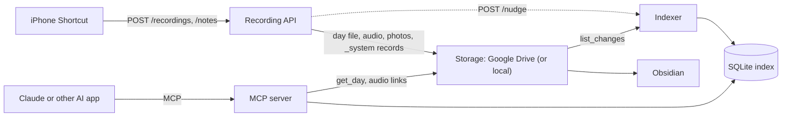

# Architecture



All three programs are the `lifelog` Python package, built into one Docker image and started
with different commands (`docker-compose.yml`). They share a `/data` volume holding the SQLite
index (and the local storage root when `LIFELOG_STORAGE_BACKEND=local`).

## Shared foundation

* `lifelog/config.py`: all settings, from `LIFELOG_*` environment variables / `.env`.
* `lifelog/storage/`: the `Storage` interface with `local` and `gdrive` backends.
* `lifelog/dayfile.py`: the day-file format, paths and merge rules.
* `lifelog/index/schema.py`: the SQLite schema.
* `lifelog/embeddings.py`, `lifelog/nudge.py`: small helpers used by two programs each.

Precise signatures: `docs/contracts.md`.

## Storage layout

```
LifeLog/
  2026/10/2026-10-10/
    2026-10-10.md          facts in the front matter, journal, notes, transcript
    2026-10-10-2130.m4a    compressed voice note
    photo-01.jpg           resized copy (originals stay in Google Photos)
  _system/
    runs/                  activity records: models, prompt version, timings, cost, errors
    generated/YYYY/MM/     exact copy of each day file as the system last wrote it
    feedback/              one JSON file per MCP feedback call
    index-backup/          daily copy of the SQLite index
    reports/               weekly reports (later)
```

## Recording API (`lifelog/api/`)

1. Authenticate the bearer token (`LIFELOG_API_TOKEN`).
2. Work out the entry date with `dayfile.entry_date` (before 4 a.m. = previous day).
3. Transcribe (`LIFELOG_STT_*`), compress audio to `.m4a` with ffmpeg, resize photos.
4. Read the existing day file (if any), `merge_capture` the new capture.
5. Extract facts and write the journal with LiteLLM (`LIFELOG_LLM_*`, prompts in `prompts/`).
   If the day is not user-edited, `apply_generation`; otherwise `merge_generation_additive`.
6. Write the day file, the `_system/generated/` snapshot and an activity record; nudge the indexer.

## Indexer (`lifelog/indexer/`)

* Every `LIFELOG_INDEXER_POLL_INTERVAL_SECONDS`, and immediately on `POST /nudge`, calls
  `storage.list_changes(sync_token)` and processes the changes.
* For each day file: parse, upsert `days` and fact tables, split into `passages`, embed new or
  changed passages (`embed_texts`), and compare with the `_system/generated/` snapshot to store
  `edit_signals`.
* Stores the new token in `meta.sync_token`. `rebuild` = `reset_derived` + full sync.
* Copies the index to `_system/index-backup/` every `LIFELOG_INDEXER_BACKUP_INTERVAL_HOURS`.

## MCP server (`lifelog/mcp_server/`)

* Tools: `search` (FTS5 + vector, merged), `get_day` (day file + private audio links via
  `storage.get_share_link`), `query_facts` (fact tables), `on_this_day`, `feedback` (writes the
  `feedback` table and a JSON copy under `_system/feedback/`).
* Transports: stdio for local apps, streamable HTTP with OAuth for phone apps
  (`LIFELOG_MCP_*`). Answers cite dates.

## Self-improvement loop

Signals (edits, feedback, activity records, quality-check scores) feed a weekly report, which a
scheduled coding agent turns into pull requests that you approve. See the plan summary in
`docs/learnings.md` and the decisions in `docs/decisions/`.
