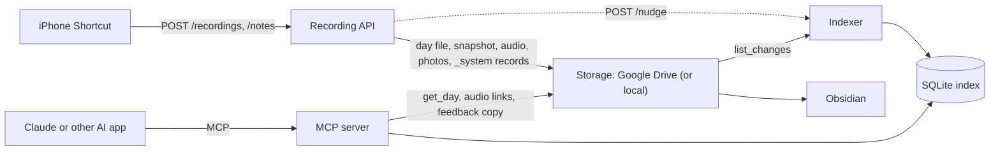

# Architecture



All three programs are the `lifelog` Python package, built into one Docker image and started
with different commands (`docker-compose.yml`). They share a `/data` volume holding the SQLite
index, the MCP OAuth state (and the local storage root when `LIFELOG_STORAGE_BACKEND=local`).
Only the API (8000) and the MCP server (8002) publish ports; the indexer (8001) is reachable only
inside the Docker network because `POST /nudge` has no authentication.

| Program | Code | Reference |
|---|---|---|
| Recording API | `lifelog/api/`, `lifelog/pipeline/`, `prompts/` | `docs/recording-api.md`, `docs/iphone-shortcuts.md` |
| Indexer | `lifelog/indexer/` | `docs/indexer.md` |
| MCP server | `lifelog/mcp_server/` | `docs/mcp-server.md` |

## Shared foundation

* `lifelog/config.py`: all settings, from `LIFELOG_*` environment variables / `.env`.
* `lifelog/storage/`: the `Storage` interface with `local` and `gdrive` backends.
* `lifelog/dayfile.py`: the day-file format, paths and merge rules.
* `lifelog/index/schema.py`: the SQLite schema.
* `lifelog/embeddings.py`, `lifelog/nudge.py`: small helpers used by two programs each.

Precise signatures: `docs/contracts.md`.

## Storage layout

```
LifeLog/
  2026/10/2026-10-10/
    2026-10-10.md          facts in the front matter, journal, notes, transcript
    2026-10-10-2130.m4a    compressed voice note
    photo-01.jpg           resized copy without EXIF (originals stay in Google Photos)
  _system/
    inbox/<capture id>/    raw uploads waiting for the worker (deleted when done)
    captures/<id>.json     capture status, no journal content
    generated/YYYY/MM/     exact copy of each day file as the system last wrote it
    activity/YYYY/MM.jsonl activity records: models, prompt versions, timings, cost, errors
    feedback/YYYY/MM/      one JSON file per MCP feedback call
    index-backup/          daily copy of the SQLite index
    reports/               weekly reports (later)
```

## Recording API (`lifelog/api/`, `lifelog/pipeline/`)

1. Authenticate the bearer token (`LIFELOG_API_TOKEN`; missing, placeholder or short tokens make
   every request fail with `503`).
2. Save the upload to `_system/inbox/<id>/` and a status to `_system/captures/`, answer `202`.
3. One worker thread processes captures in order: entry date with `dayfile.entry_date` (before
   4 a.m. = previous day); compress audio to `.m4a` (ffmpeg → afconvert → keep the original);
   transcribe (`LIFELOG_STT_*`); resize photos.
4. Read the existing day file (if any), `merge_capture` the new capture, write the day file and
   its `_system/generated/` snapshot. The transcript is now safe.
5. Extract facts and write the journal with LiteLLM (`LIFELOG_LLM_*`, prompts in `prompts/`).
   If the day is not user-edited, `apply_generation`; otherwise `merge_generation_additive`.
   The day file is re-read before writing so an edit made meanwhile is never overwritten.
6. Write the day file and its snapshot again (same text, same `generated_at`), nudge the indexer,
   append an activity record, mark the capture `done`.

## Indexer (`lifelog/indexer/`)

* One worker thread owns the index. Every `LIFELOG_INDEXER_POLL_INTERVAL_SECONDS`, and right
  after a `POST /nudge`, it indexes the nudged paths, then calls
  `storage.list_changes(sync_token)` (a full scan once a day) and processes the changes.
* For each changed day file: parse, upsert `days` and fact tables, split into `passages`, embed
  new or changed passages (`embed_texts`, unchanged ones reuse their vectors), and compare with
  the `_system/generated/` snapshot to store `edit_signals` (only when both have the same
  `generated_at`). One transaction per day.
* `rebuild` = `reset_derived` + full sync (automatic when the embedding model changes).
* Copies the index to `_system/index-backup/` every `LIFELOG_INDEXER_BACKUP_INTERVAL_HOURS`.

## MCP server (`lifelog/mcp_server/`)

* Tools: `search` (FTS5 + vector, reciprocal rank fusion), `get_day` (day file from storage +
  private audio/photo links via `storage.get_share_link`), `query_facts` (fact tables with
  aggregates), `on_this_day`, `feedback` (writes the `feedback` table and a JSON copy under
  `_system/feedback/`).
* Each call opens its own read-only index connection, so the indexer can sync at any time.
* Transports: stdio for local apps, streamable HTTP for remote and phone apps with auth mode
  `token` (static bearer) or `oauth` (single-owner OAuth 2.1 with a password page). Server
  instructions tell the AI app to answer only from the entries and cite dates.

## Tested end to end

`tests/e2e/test_full_flow.py` runs all three programs in-process on local storage with the
offline providers: captures through the API, indexing via a real nudge, every MCP tool, an owner
edit producing edit signals, and an additive capture that keeps the edit. Every test, with
what it checks in plain English: `docs/test-cases.md`.

## Self-improvement loop

Signals (edits, feedback, activity records, quality-check scores) feed a weekly report, which a
scheduled coding agent turns into pull requests that you approve. See `docs/learnings.md` and
the decisions in `docs/decisions/`.
