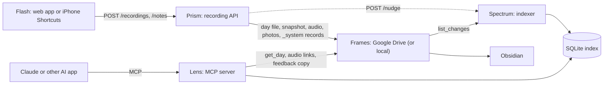
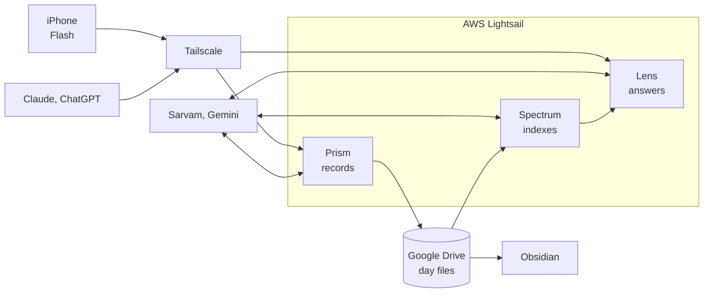

# Architecture

A **Flash** captures the moment, the **Prism** splits it into its colors, each day becomes a
**Frame**, the **Spectrum** lays everything out in order, and the **Lens** lets you zoom into
any day. (Why these names: decision 0042.)



All three programs are the `lumitrace` Python package, built into one Docker image and started
with different commands (`docker-compose.yml`, services `prism`, `spectrum` and
`lens`). They share a `/data` volume holding the SQLite index, the MCP OAuth state (and
the local storage root when `LUMITRACE_STORAGE_BACKEND=local`). Only the Prism (8000) and the
Lens (8002) publish ports; Spectrum (8001) is reachable only inside the Docker network
because `POST /nudge` has no authentication.

| Name | Program | Code | Reference |
|---|---|---|---|
| Flash | web app served by the Prism at `/flash/`, and iPhone Shortcuts (not in the repo) | `lumitrace/prism/web/`, `lumitrace/prism/flash.py` | `docs/flash.md` |
| Prism | recording API, `lumitrace-prism` | `lumitrace/prism/`, `lumitrace/prism/pipeline/`, `prompts/` | `docs/prism.md` |
| Spectrum | indexer, `lumitrace-spectrum` | `lumitrace/spectrum/` | `docs/spectrum.md` |
| Lens | MCP server, `lumitrace-lens` | `lumitrace/lens/` | `docs/lens.md` |

## Deployment and providers

The big picture in production. Every model and service can be swapped in config
(`docs/tech-stack.md`).



Tailscale is the only way in: the Prism is reachable from your own devices only, and just the
Lens is public so AI apps can connect (decisions 0041 and 0044).

## Shared foundation

* `lumitrace/config.py`: all settings, from `LUMITRACE_*` environment variables / `.env`.
* **Frames** (`lumitrace/frames/`): `dayfile.py` is the day-file format, paths and merge rules;
  `storage/` is the `Storage` interface with `local` and `gdrive` backends.
* `lumitrace/index/schema.py`: the SQLite schema. It stays outside `lumitrace/spectrum/` because
  Spectrum writes the index and the Lens reads it.
* `lumitrace/embeddings.py`, `lumitrace/nudge.py`: small helpers used by two programs each.

Precise signatures: `docs/contracts.md`.

## Storage layout (the Frames)

```
Lumitrace/
  2026/10/2026-10-10/
    2026-10-10.md          front matter, journal, notes, Telugu transcript
    2026-10-10-2130.m4a    compressed voice note
    photo-01.jpg           resized copy without EXIF (originals stay in Google Photos)
  _system/
    inbox/<capture id>/    raw uploads waiting for the worker (deleted when done)
    captures/<id>.json     capture status, no journal content
    generated/YYYY/MM/     exact copy of each day file as the system last wrote it
    activity/YYYY/MM.jsonl activity records: models, timings, cost, errors
    feedback/YYYY/MM/      one JSON file per MCP feedback call
    index-backup/          daily copy of the SQLite index
    reports/               weekly reports (later)
```

## Prism: recording API (`lumitrace/prism/`, `lumitrace/prism/pipeline/`)

1. Authenticate the bearer token (`LUMITRACE_API_TOKEN`; missing, placeholder or short tokens make
   every request fail with `503`).
2. Save the upload to `_system/inbox/<id>/` and a status to `_system/captures/`, answer `202`.
3. One worker thread processes captures in order: entry date with `dayfile.entry_date` (before
   4 a.m. = previous day); compress audio to `.m4a` (ffmpeg → afconvert → keep the original);
   transcribe (`LUMITRACE_STT_*`); resize photos.
4. Read the existing day file (if any), `merge_capture` the new capture, write the day file and
   its `_system/generated/` snapshot. The transcript is now safe. During an open day the journal
   waits until 4:05 a.m.
5. One LiteLLM call (`LUMITRACE_LLM_WRITE_JOURNAL_MODEL`, prompts in `prompts/`). At 4:05, or
   the first write of a day that has already closed, `fill_day` then
   `apply_generation(..., force=True)` uses every recording plus My notes. Once a journal exists,
   changed source uses `update_day`; it returns missing bullets classified into the normal
   journal sections, and `merge_generation_additive` inserts them without rewriting existing
   words. `generated_source_hash` makes unchanged Generate calls and capture replays no-ops.
6. Write the day file and its snapshot again (same text, same `generated_at`), nudge Spectrum,
   append an activity record, mark the capture `done`.

## Spectrum: indexer (`lumitrace/spectrum/`)

* One worker thread owns the index. Every `LUMITRACE_INDEXER_POLL_INTERVAL_SECONDS`, and right
  after a `POST /nudge`, it indexes the nudged paths, then calls
  `storage.list_changes(sync_token)` (a full scan once a day) and processes the changes.
* For each changed day file: parse, upsert `days` and fact tables, split into `passages`, embed
  new or changed passages (`embed_texts`, unchanged ones reuse their vectors), and compare with
  the `_system/generated/` snapshot to store `edit_signals` (only when both have the same
  `generated_at`). One transaction per day.
* `rebuild` = `reset_derived` + full sync (automatic when the embedding model changes).
* Copies the index to `_system/index-backup/` every `LUMITRACE_INDEXER_BACKUP_INTERVAL_HOURS`.

## Lens: MCP server (`lumitrace/lens/`)

* Tools: `search` (FTS5 + vector, reciprocal rank fusion), `get_day` (day file from storage +
  private audio/photo links via `storage.get_share_link`), `query_facts` (fact tables with
  aggregates), `on_this_day`, `feedback` (writes the `feedback` table and a JSON copy under
  `_system/feedback/`).
* Each call opens its own read-only index connection, so Spectrum can sync at any time.
* Transports: stdio for local apps, streamable HTTP for remote and phone apps with auth mode
  `token` (static bearer) or `oauth` (single-owner OAuth 2.1 with a password page). Server
  instructions tell the AI app to answer only from the entries and cite dates.

## Tested end to end

`tests/e2e/test_full_flow.py` runs all three programs in-process on local storage with the
offline providers: captures through the Prism, indexing by the Spectrum via a real nudge, every
Lens tool, an owner edit producing edit signals, and a later capture that keeps the edit. Every test, with
what it checks in plain English: `docs/test-cases.md`.

## Self-improvement loop

Signals (edits, feedback, activity records, quality-check scores) feed a weekly report, which a
scheduled coding agent turns into pull requests that you approve. See `docs/learnings.md` and
the decisions in `docs/decisions/`.
