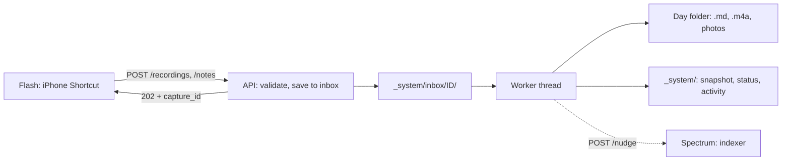

# Prism (recording API)

The Prism takes what a Flash (the web app or the iPhone Shortcuts) captures and splits that one beam of raw
voice into its colors: facts, journal, mood and transcript, written into the day's Frame (the
day file). Command: `lumitrace-prism`; Docker service: `prism`. Owned by the
prism work stream. Code: `lumitrace/prism/` (HTTP, inbox, worker) and
`lumitrace/prism/pipeline/` (speech to text, AI steps, audio, photos, activity records).
Tests: `tests/prism/`. iPhone side: `docs/flash.md`.



## Endpoints

All endpoints except `/health`, the Flash web app's files and its sign-in endpoints need
`Authorization: Bearer <LUMITRACE_API_TOKEN>` **or** the Flash web app's session cookie (see
*Flash web app endpoints*). A missing or wrong token gets `401` (with
`WWW-Authenticate: Bearer`). If the server's token is missing, still `change-me` or shorter than
16 characters, it refuses everything with `503` (fails closed) and logs an error at start-up. The
token is compared in constant time. When an `Authorization` header is sent, only the token is
checked (the cookie is ignored).

### `POST /recordings` (Log My Day)

`multipart/form-data`:

| Field | Required | Meaning |
|---|---|---|
| `audio` | yes | the voice recording (any format; iPhone Record Audio gives `.m4a`) |
| `photos` or `photos[]` (or `photo`) | no | any number of image files (HEIC, JPEG, PNG, ...); max 60 |
| `captured_at` | no | when it was recorded: ISO-8601 (`2026-10-10T21:30:00-05:00`; no offset = server timezone) or Unix seconds. Default: now |
| `date` | no | the day the capture belongs to, `YYYY-MM-DD` (`2026-10-08`); not after today (ADR 0017). Empty or missing: the day of `captured_at` (default now) in `LUMITRACE_TIMEZONE`, before `LUMITRACE_DAY_ROLLOVER_HOUR` counting as the previous day. `422` if malformed or in the future |
| `lat`, `lon` | no | decimal degrees |
| `place` | no | a place name, e.g. the city from Get Details of Locations |
| `capture_id` | no | client id for safe retries: letters, digits, `.`, `_`, `-`, max 128 |

Response `202 Accepted` (new) or `200 OK` (this `capture_id` was already received):

```json
{
  "capture_id": "20261010T213000-recording-3fa2b1",
  "kind": "recording",
  "status": "queued",
  "entry_date": "2026-10-10",
  "duplicate": false,
  "status_url": "/captures/20261010T213000-recording-3fa2b1",
  "message": "Recording saved for Saturday, October 10. Your journal updates in a minute."
}
```

`message` is meant to be shown as the Shortcut's notification.

### `POST /notes` (Quick Note)

Same fields, but `audio` is optional and `text` is added; at least one of `text`, `audio` or a
photo is required (text and audio: the transcript is appended after the text; photos only: e.g.
photos shared from the Photos app). Accepts `multipart/form-data`,
`application/x-www-form-urlencoded` or `application/json` (text-only notes, e.g.
`{"text": "...", "captured_at": "...", "date": "2026-10-08", "capture_id": "..."}`). Same
response.

### `GET /captures/{capture_id}`

```json
{
  "capture_id": "phone-001",
  "kind": "recording",
  "status": "done",
  "entry_date": "2026-10-10",
  "captured_at": "2026-10-10T21:30:00-05:00",
  "received_at": "2026-10-11T02:30:04Z",
  "updated_at": "2026-10-11T02:30:41Z",
  "attempts": 1,
  "retry_at": null,
  "day_file": "2026/10/2026-10-10/2026-10-10.md",
  "audio": "2026-10-10-2130.m4a",
  "photos": ["photo-01.jpg"],
  "generation": "full",
  "errors": [],
  "warnings": []
}
```

* `status`: `queued` → `processing` → `done`, or `failed` after the automatic retries. While an
  automatic retry is waiting, `status` is `queued` and `retry_at` is set.
* `generation`: `full` (facts, title and journal regenerated for the whole day), `additive` (the
  day was edited by the owner, so only additions; see below), `skipped` (no words), or `failed`
  (the transcript is saved but every AI model failed; `errors` says which step).
* `404` for an unknown id.

### `POST /captures/{capture_id}/retry`

Re-queues a `failed` capture whose upload is still in the inbox. `409` if it is not failed,
`410` if the upload is gone (send it again). Returns the status.

### `GET /health`

`{"status": "ok", "service": "api", "version": "0.1.0"}`, no token.

### Flash web app endpoints

Code: `lumitrace/prism/flash.py` (routes, summary), `lumitrace/prism/auth.py` (sessions), the
app itself in `lumitrace/prism/web/` (ADR 0019; user guide: `docs/flash.md` → section 0).

| Endpoint | Auth | What it does |
|---|---|---|
| `GET /flash/` | none | the web app (HTML, CSS, JS, service worker, manifest, icons); `GET /` and `GET /flash` redirect here. Sent with a strict `Content-Security-Policy` (same-origin only, no framing) |
| `POST /login` | none | JSON `{"username": "...", "password": "..."}`. Right: `200` with `{"signed_in": true, "username", "sign_in_available", "version"}` and a session cookie. Wrong: `401` after 0.5 s. Five wrong attempts in 15 minutes: `429` until the window passes. Sign-in not set up: `503`. From another site (`Sec-Fetch-Site: cross-site`): `403` |
| `POST /logout` | none | `204`; deletes the cookie |
| `GET /session` | none | `{"signed_in", "username", "sign_in_available", "version"}` for the cookie sent (never an error) |
| `GET /captures?days=7&limit=30` | token or cookie | the capture statuses (same shape as `GET /captures/{id}`) changed in the last `days` (1–60), newest capture first, at most `limit` (1–200). No journal content |
| `GET /summary` | token or cookie | `{"today", "days": 7, "days_logged", "logged_dates", "captures", "streak"}` |
| `GET /lens/apps` | token or cookie | the AI apps connected to the Lens, passed through from its admin API (`docs/lens.md` → Connected apps) |
| `POST /lens/apps/{id}/sign-out` | token or cookie | disconnect one app now (it needs the Lens password again) |
| `POST /lens/apps/sign-out-all` | token or cookie | disconnect every app; `{"signed_out": n}` |

**Connected AI apps** (`lumitrace/prism/lens_apps.py`, decision 0036): the Prism calls the
Lens's private admin API at `LUMITRACE_MCP_ADMIN_URL` with `LUMITRACE_API_TOKEN` (5-second
timeout). The Lens's answer is passed through; an unknown app is `404`; a Lens that is down or
refuses the token is `502` (never `401`, which the web app treats as its own sign-out).

**Sign-in** is on when `LUMITRACE_FLASH_USERNAME` is set, `LUMITRACE_FLASH_PASSWORD` is at least
10 characters (not `change-me`) and `LUMITRACE_API_TOKEN` is valid; otherwise `POST /login`
answers `503` and the start-up log says why (INFO). Both fields are compared in constant time.

**Session cookie** `lumitrace_flash` = `v1.<expiry unix seconds>.<HMAC-SHA256 hex>`, keyed by a
hash of the API token, username and password: changing any of them signs every browser out. No
session is stored on the server. Attributes: `HttpOnly`, `SameSite=Strict`, `Path=/`,
`Max-Age` = `LUMITRACE_FLASH_SESSION_DAYS` days, and `Secure` unless the request is plain HTTP to
`localhost`/`127.0.0.1`. A request authenticated by the cookie that is not `GET`/`HEAD`/`OPTIONS`
and carries `Sec-Fetch-Site: cross-site` is refused with `403`.

**Summary:** `today` is the current journal day (timezone and rollover hour as for captures).
`days_logged` and `logged_dates` are the days in the last 7 (today included) that have a day file;
`captures` counts the transcript entries in those files; `streak` is the number of days in a row
with a day file, ending today, or yesterday while today has none yet (looked up month by month,
at most 24 months back).

### Errors

`401` / `503` auth, `413` upload larger than `LUMITRACE_API_MAX_UPLOAD_MB`, `415` unsupported
content type, `422` invalid fields (message in `detail`), `404` unknown capture.

### Examples

```bash
TOKEN=...; API=https://lumitrace.example.com
curl -H "Authorization: Bearer $TOKEN" -F audio=@memo.m4a -F photos=@a.heic -F photos=@b.heic \
     -F lat=30.2672 -F lon=-97.7431 -F place=Austin -F captured_at=2026-10-10T21:30:00-05:00 \
     -F capture_id=test-001 "$API/recordings"
curl -H "Authorization: Bearer $TOKEN" -H 'Content-Type: application/json' \
     -d '{"text": "Lunch at the taco truck."}' "$API/notes"
curl -H "Authorization: Bearer $TOKEN" "$API/captures/test-001"
```

## Durable inbox and background processing

The upload is written to storage before the response, and processed afterwards by one worker
thread (ADR 0010):

1. Parse and validate the request (auth first, then size, fields).
2. Write the raw files to `_system/inbox/<capture_id>/` (`audio.<ext>`, `photo-NN.<ext>`), then
   `manifest.json` (a `CaptureRequest`) last. A folder without a manifest is an interrupted
   upload and is ignored.
3. Write `_system/captures/<capture_id>.json` (`CaptureStatus`, status `queued`) and queue it.
4. Answer `202`.

**Idempotency:** a `capture_id` whose status exists and is not `failed` is not stored again; the
response is `200` with `duplicate: true` and the current status. A `failed` one is replaced by the
new upload and queued again. The day file is also idempotent (`merge_capture` ignores a capture
id it already has), so a retry can never duplicate an entry. Without a `capture_id` the server
makes one (`<YYYYMMDDTHHMMSS>-<kind>-<random>`), so every such request is a new capture.

**Worker:** one daemon thread processes captures in arrival order, so two captures for the same
day never race on the day file. A failure is retried after 60 s and 10 min (three attempts),
then left `failed` in the inbox for `POST /captures/{id}/retry` or a re-send.

**Restart:** on start-up the API lists `_system/inbox/`, re-queues `queued` and `processing`
captures (a crash mid-way is safe: a capture already in the day file is not added again, only
regenerated), creates a status for manifests that have none, cleans up `done` leftovers, and
leaves `failed` ones alone. On shutdown the worker finishes the capture in progress.

The status files stay after processing (small, no journal content) so `GET /captures/{id}` and
retries keep working. The inbox folder is deleted once a capture is `done`.

## Pipeline

`lumitrace.prism.pipeline.processor.CaptureProcessor.process(request)`; each step is timed into the
activity record.

1. **Entry date:** the `date` field if one was sent (kept in the inbox manifest as
   `CaptureRequest.entry_date`, so retries and restarts use it too), otherwise
   `entry_date(captured_at, LUMITRACE_TIMEZONE, LUMITRACE_DAY_ROLLOVER_HOUR)`; before 4 a.m. counts
   as the previous day. The capture time is stored in the local timezone either way.
2. **Audio** (`pipeline/audio.py`, ADR 0013): compress to `.m4a`, AAC, mono, at
   `LUMITRACE_AUDIO_BITRATE_KBPS` with `ffmpeg`, else macOS `afconvert`. If neither exists or both
   fail, the original is kept unchanged (with its own extension, e.g. `.wav`; MPEG-4 audio keeps
   `.m4a`) and a warning is logged and recorded. If an `.m4a` original is already smaller than
   the compressed copy, the original is kept.
3. **Speech to text** (`pipeline/stt.py`), by `LUMITRACE_STT_PROVIDER`:
   * `litellm`: `litellm.transcription(model=LUMITRACE_STT_MODEL, language=LUMITRACE_STT_LANGUAGE)`.
     An empty `LUMITRACE_STT_LANGUAGE` omits the language so the model detects it per recording
     (use this for mixed speech such as Telugu and English; `en` forces English).
     The original audio is sent (best quality) unless it is over 24 MB or in a format hosted APIs
     reject; then the compressed copy is sent.
   * `aws_transcribe`: uploads to `LUMITRACE_AWS_TRANSCRIBE_BUCKET` under `lumitrace-stt/`, runs a
     batch job, reads the result and deletes the media, the result and the job. `en` is sent as
     `en-US` (also `es`, `fr`, `de`, ... mapped; `xx-YY` codes are used as-is; anything else uses
     language identification). Turn on the **AWS Organizations AI services opt-out policy** so
     AWS does not use the audio to improve its models. Needs `boto3` and AWS credentials.
   * `sarvam` (ADR 0015): Sarvam's Saaras batch API (`https://api.sarvam.ai`, header
     `api-subscription-key: LUMITRACE_SARVAM_API_KEY`; recordings up to 2 hours). Two jobs run at
     the same time on the same audio: the **transcript** in `LUMITRACE_SARVAM_MODE` (default
     `codemix`: English words in English, Telugu or other Indian-language words in their own
     script) and, with `LUMITRACE_SARVAM_TRANSLATE=true`, an **English translation** (`translate`
     mode). Each job: create (`POST /speech-to-text/job/v1` with `model`, `mode`,
     `language_code`, `keyterms`), get a presigned upload URL, `PUT` the audio
     (`x-ms-blob-type: BlockBlob`; the API key is never sent to the storage URL), start, poll the
     status, then download the result JSON and read `transcript`. `LUMITRACE_STT_LANGUAGE=te`
     becomes `te-IN` (`xx-YY` is used as-is, empty means `unknown` = detect). `keyterms` (only
     sent to `saaras:v4`) are the `LUMITRACE_FAMILY` names plus `LUMITRACE_STT_KEYTERMS`, at most
     50, each cut to 64 characters; they help the names come out right. A failed transcript job
     fails the capture (it is retried); a failed translation job only adds a
     `transcribe: translation: ...` warning and the capture keeps its transcript. Errors never
     echo the presigned URLs (they carry access tokens). Sarvam has no endpoint to delete a job;
     check its data-retention terms before sending private audio. `models_used.stt` is
     `sarvam/<model>`; no cost is recorded (Sarvam prices in rupees per hour of audio).
   * `fake`: offline; uploaded bytes that are UTF-8 text become the transcript.
   If transcription fails nothing has been written yet, so the capture is simply retried. A
   translation is stored in the capture block below the transcript (`Capture.translation`,
   `docs/frames-format.md` → Capture metadata).
4. **Photos** (`pipeline/photos.py`): Pillow + pillow-heif (HEIC); rotated upright from EXIF,
   fitted within `LUMITRACE_PHOTO_MAX_DIMENSION`, saved as JPEG at `LUMITRACE_PHOTO_JPEG_QUALITY`
   without EXIF (no GPS or device data in the copy). Named with `next_photo_names()` after the
   highest existing `photo-NN.jpg` in the day folder. Files that are not images are skipped with a
   warning.
5. **Save the capture:** audio (`audio_file_name()` + `unique_file_name()`, e.g.
   `2026-10-10-2130.m4a`, `2026-10-10-2130-2.m4a`) and photos go into the day folder; the day file
   is re-read and `merge_capture` adds the transcript block; the day file and its
   `_system/generated/` snapshot are written. From here on the capture is safe even if the AI
   steps fail (ADR 0011).
6. **AI steps** (`pipeline/generate.py`, `pipeline/llm.py`), only if the day has any words:
   * Day **not** edited by the owner → **full**: `extract_facts` over all of the day's captures
     (JSON validated against `DayFacts`; `keep_family` gives every `LUMITRACE_FAMILY` member a block,
     empty if the day says nothing about them, spelled as configured, and drops anyone else;
     meal types are mapped to the five fixed ones), then `write_journal` (JSON
     `{headline, journal}`), then `apply_generation` with the title
     `"<Weekday, Month D, YYYY> · <headline>"`, which gives the journal the fixed headings
     (`normalize_journal`, `docs/frames-format.md` → The journal).
   * Day **edited** (`DayFile.is_user_edited()`) → **additive**: `extract_facts` over the new
     capture only, `journal_addendum` (a short paragraph about the new entry, given the edited
     journal as context), then `merge_generation_additive`, which appends the paragraph under
     `## Later` with the label `**HH:MM · Quick Note**`.
     Existing facts, title and journal are never changed; new places, people, highlights and
     family items are appended.
   * Before writing, the day file is read **again**. If the owner edited it while the AI was
     working, a full result is thrown away and the additive path runs instead, so a concurrent
     edit is never overwritten.
   * If one step fails on every model, the other step's result is still applied (facts without a
     new journal, or a journal with the old facts). If both fail, the day keeps the transcript
     and `generation` is `failed`.
   * Front matter: `prompt_version` (e.g. `extract_facts-v4+write_journal-v3`) and `models_used`
     (`stt`, `extract_facts`, `write_journal` or `journal_addendum`: the models that actually
     answered), merged with what was there.
7. **Write** the day file and its snapshot again.
8. **Nudge** the indexer (`nudge_indexer` with the day file, audio and photo paths). A failed or
   refused nudge is recorded but never fails the capture; the indexer also polls.
9. **Activity record** appended (also for failed attempts); the worker then marks the status
   `done` and deletes the inbox folder.

### Models and fallback

Each AI call goes to the task's model (`LUMITRACE_LLM_EXTRACT_FACTS_MODEL`,
`LUMITRACE_LLM_WRITE_JOURNAL_MODEL`; the addendum uses the journal model) with
`response_format={"type": "json_object"}`, `timeout=LUMITRACE_LLM_TIMEOUT_SECONDS`,
`num_retries=LUMITRACE_LLM_MAX_RETRIES` and `drop_params=True` (LiteLLM drops parameters a provider
does not support). A provider error, a reply that is not JSON (code fences and chatter around the
object are tolerated) or a reply that fails validation counts as a failure of that model, and the
same request goes to `LUMITRACE_LLM_FALLBACK_MODEL` (ADR 0014). An out-of-range `mood_score` is set
to null instead of rejecting the whole reply.

The model string **`fake`** never calls a provider: facts come back empty and the journal is the
day's text under `## Summary`. With `LUMITRACE_STT_PROVIDER=fake` and the three `LUMITRACE_LLM_*`
models set to `fake`, the whole API runs offline.

### Prompts

Versioned files in `prompts/<task>/<version>.md` (`prompts/README.md`): `extract_facts/v4.md`,
`write_journal/v3.md`, `journal_addendum/v3.md` (older versions are kept for reference). The
current versions are in `lumitrace.prism.pipeline.prompts.PROMPT_VERSIONS`. Each file has a
system part and a user part separated by `<!-- lumitrace-prompt: system -->` /
`<!-- lumitrace-prompt: user -->`, with `{{name}}` placeholders (`date`, `location`, `captures`,
`facts`, `journal`, `capture`, `author`, `family`). A missing value raises an error. Prompts tell
the model to use only what the entries say and never invent.

The current versions (ADR 0016) also tell the model:

* **Who is speaking and how everyone is related:** `author` is the `LUMITRACE_FAMILY` member
  marked `(me)` (`(not given)` otherwise) and `family` lists every member with their relation,
  e.g. `Sam (the author), Maya (the author's wife), Leo`. Relationship words in any language
  (Dad, Amma, Nanna, ...) are resolved from the point of view of whoever says them, and the
  author's own facts go in their family block.
* **Who did what:** every action, meal, place and feeling belongs to the person who did it;
  "we" is the author plus whoever it clearly includes; the journal never makes the author the
  subject of something someone else did.
* **How to read the entries:** a recording with a translation is shown as
  `English translation (machine-made from the audio):` followed by
  `Original transcript (as spoken):`. The model reads both and follows the original when they
  disagree (machine translations mix up who did what and mistranslate idioms; v4/v3, ADR 0018),
  leaves a detail out only when neither makes sense, never turns a misheard phrase into a food,
  place or name, and writes in English. Parents talking about themselves in their child's words
  ("Dad went to bed early") mean the author.
* **The author's own block** (`extract_facts` v4) always repeats the author's mood, meals,
  places, activities and moments; a meal eaten without a named food is described from the
  entry ("food from the deli") instead of borrowing another meal's food, and a meal's type may
  come from the order of events. Feelings and worries anyone expressed are kept as moments and
  in the journal.
* **The facts can be wrong:** `write_journal` follows the entries when the extracted facts
  disagree with them, and uses Morning/Afternoon/Evening only for events the entries place
  there.

## Activity records (`_system/activity/YYYY/MM.jsonl`)

One JSON line per processing attempt, appended to the file for the month the attempt finished
(UTC), written by `lumitrace.prism.pipeline.activity.ActivityLog` (ADR 0012). Example (fictional):

```json
{"capture_id": "phone-001", "kind": "recording", "attempt": 1, "status": "done",
 "entry_date": "2026-10-10", "received_at": "...", "started_at": "...", "finished_at": "...",
 "generation": "full", "prompt_versions": {"extract_facts": "v3", "write_journal": "v2"},
 "models": {"stt": "openai/gpt-4o-transcribe", "extract_facts": "openai/gpt-4o-mini",
            "write_journal": "openai/gpt-4o"},
 "steps": [
   {"name": "compress_audio", "ms": 812, "ok": true,
    "detail": {"bytes_in": 5242880, "bytes_out": 1468006, "compressor": "ffmpeg"}},
   {"name": "transcribe", "ms": 9120, "ok": true, "model": "openai/gpt-4o-transcribe",
    "cost_usd": 0.036, "detail": {"audio_bytes": 5242880, "chars": 4210}},
   {"name": "write_day", "ms": 640, "ok": true, "detail": {"captures": 2}},
   {"name": "extract_facts", "ms": 3010, "ok": true, "model": "openai/gpt-4o-mini",
    "cost_usd": 0.0009},
   {"name": "write_journal", "ms": 7400, "ok": true, "model": "openai/gpt-4o",
    "cost_usd": 0.012},
   {"name": "write_day", "ms": 590, "ok": true, "detail": {"mode": "full"}},
   {"name": "nudge", "ms": 15, "ok": true, "detail": {"accepted": true}}],
 "cost_usd": 0.0489, "errors": [], "warnings": []}
```

* Steps: `compress_audio`, `transcribe`, `photos`, `write_day`, `extract_facts`,
  `write_journal`, `journal_addendum`, `nudge`. When the fallback model was needed, the step's
  `detail.attempts` lists each model with `ok`, `ms` and the error.
* `cost_usd` comes from LiteLLM (`_hidden_params.response_cost` or `completion_cost`) and is
  missing when LiteLLM does not know the price (e.g. Amazon Transcribe, local models).
* **No journal content**: no transcript, note text, facts, journal, names, places or file
  contents. Only sizes, counts, models, timings and errors. Error texts go through `safe_error`:
  validation and JSON errors keep only their type and count (their messages would echo model
  output), other messages are cut to 200 characters.
* Storage has no append, so each record is a read-modify-write of the month file under a lock
  (the API is the only writer). A failure to write the record is logged and never fails a
  capture.

## Files written

| Path | Content |
|---|---|
| `YYYY/MM/YYYY-MM-DD/YYYY-MM-DD.md` | the day file (`docs/frames-format.md`) |
| `YYYY/MM/YYYY-MM-DD/YYYY-MM-DD-HHMM.m4a` | compressed audio |
| `YYYY/MM/YYYY-MM-DD/photo-NN.jpg` | resized photos |
| `_system/generated/YYYY/MM/YYYY-MM-DD.md` | snapshot of each day file write |
| `_system/inbox/<id>/` | raw uploads waiting to be processed (deleted when done) |
| `_system/captures/<id>.json` | capture status (no journal content) |
| `_system/activity/YYYY/MM.jsonl` | activity records |

## Configuration

| Setting | Use here |
|---|---|
| `LUMITRACE_API_TOKEN` | bearer token; at least 16 characters (`openssl rand -hex 32`); if it is missing, `change-me` or short, every request except `/health` gets `503` |
| `LUMITRACE_FLASH_USERNAME`, `LUMITRACE_FLASH_PASSWORD`, `LUMITRACE_FLASH_SESSION_DAYS` | Flash web app sign-in (password at least 10 characters) and how long it lasts (90 days) |
| `LUMITRACE_API_HOST`, `LUMITRACE_API_PORT` | where uvicorn listens |
| `LUMITRACE_API_MAX_UPLOAD_MB` | total size of one request (`413` above it) |
| `LUMITRACE_AUDIO_BITRATE_KBPS` | AAC bitrate of the stored audio |
| `LUMITRACE_PHOTO_MAX_DIMENSION`, `LUMITRACE_PHOTO_JPEG_QUALITY` | photo copies |
| `LUMITRACE_TIMEZONE`, `LUMITRACE_DAY_ROLLOVER_HOUR` | entry dates and capture times |
| `LUMITRACE_STT_PROVIDER`, `LUMITRACE_STT_MODEL`, `LUMITRACE_STT_LANGUAGE`, `LUMITRACE_STT_KEYTERMS`, `LUMITRACE_AWS_REGION`, `LUMITRACE_AWS_TRANSCRIBE_BUCKET` | speech to text |
| `LUMITRACE_SARVAM_API_KEY`, `LUMITRACE_SARVAM_MODEL` (`saaras:v4`), `LUMITRACE_SARVAM_MODE` (`codemix`), `LUMITRACE_SARVAM_TRANSLATE` (`true`) | the `sarvam` speech-to-text option |
| `LUMITRACE_LLM_EXTRACT_FACTS_MODEL`, `LUMITRACE_LLM_WRITE_JOURNAL_MODEL`, `LUMITRACE_LLM_FALLBACK_MODEL`, `LUMITRACE_LLM_TIMEOUT_SECONDS`, `LUMITRACE_LLM_MAX_RETRIES` | AI steps (`fake` = offline) |
| `LUMITRACE_FAMILY` | comma-separated family members who get their own block under Family, each optionally with their relation to the owner in parentheses, the owner marked `(me)`: `Sam (me), Maya (wife), Leo (son)`; empty = no family blocks |
| `LUMITRACE_PROMPTS_DIR` | prompt files; a relative path that does not exist falls back to the repository's `prompts/` |
| `LUMITRACE_INDEXER_NUDGE_URL` | nudge after each capture (empty = off) |
| `LUMITRACE_MCP_ADMIN_URL` | the Lens's private admin API for connected AI apps (Compose: `http://lens:8003`) |
| storage settings | where everything is written (`get_storage`) |

## Testing

`uv run pytest tests/prism` runs offline: `LocalStorage` on `tmp_path`, `stt_provider=fake`, a
scripted fake in place of `litellm.completion` (`tests/prism/conftest.py::FakeLLM`), a fake
compressor and a nudge recorder injected through `create_app(settings, processor=...)`. The
real-compressor test runs only where `ffmpeg` or `afconvert` can encode AAC (it is skipped in
sandboxes that hide the macOS codecs).

## Known limits

* Inbox uploads go to the configured storage; with Google Drive the `202` waits for the raw
  files to reach Drive (a few seconds for a long recording with many photos).
* If the server dies after writing audio/photos but before the day file, the retry writes them
  again under new names and the first copies stay as orphans in the day folder.
* A day file whose front matter the owner broke cannot be merged into; the capture fails with a
  parse error until the file is fixed, then `POST /captures/{id}/retry`.
* No reverse geocoding: the location is the `place` text plus the coordinates.
