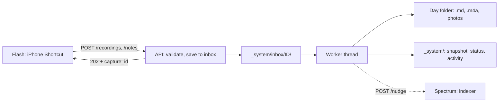

# Prism (recording API)

The Prism takes what a Flash (the web app or the iPhone Shortcuts) captures and splits that one beam of raw
voice into its colors: a timeline, family trackers and transcript, written into the day's Frame
(the day file). Command: `lumitrace-prism`; Docker service: `prism`. Owned by the
prism work stream. Code: `lumitrace/prism/` (HTTP, inbox, worker) and
`lumitrace/prism/pipeline/` (speech to text, AI steps, audio, photos, activity records).
Tests: `tests/prism/`. iPhone side: `docs/flash.md`.



## Endpoints

All endpoints except `/health`, the Flash web app's files and its sign-in endpoints need
`Authorization: Bearer <LUMITRACE_API_TOKEN>` **or** the Flash web app's session cookie (see
*Flash web app endpoints*). A missing or wrong token gets `401` (with
`WWW-Authenticate: Bearer`). If the server's token is missing, still `change-me` or shorter than
16 characters, it refuses everything with `503` (fails closed) and logs an error at start-up. The
token is compared in constant time. When an `Authorization` header is sent, only the token is
checked (the cookie is ignored).

### `POST /recordings` (Log My Day)

`multipart/form-data`:

| Field | Required | Meaning |
|---|---|---|
| `audio` | yes | the voice recording (any format; iPhone Record Audio gives `.m4a`) |
| `photos` or `photos[]` (or `photo`) | no | any number of image files (HEIC, JPEG, PNG, ...); max 60 |
| `captured_at` | no | when it was recorded: ISO-8601 (`2026-10-10T21:30:00-05:00`; no offset = server timezone) or Unix seconds. Default: now |
| `date` | no | the day the capture belongs to, `YYYY-MM-DD` (`2026-10-08`); not after today (ADR 0017). Empty or missing: the day of `captured_at` (default now) in `LUMITRACE_TIMEZONE`, before `LUMITRACE_DAY_ROLLOVER_HOUR` counting as the previous day. `422` if malformed or in the future |
| `lat`, `lon` | no | decimal degrees |
| `place` | no | a place name, e.g. the city from Get Details of Locations |
| `capture_id` | no | client id for safe retries: letters, digits, `.`, `_`, `-`, max 128 |

Response `202 Accepted` (new) or `200 OK` (this `capture_id` was already received):

```json
{
  "capture_id": "20261010T213000-recording-3fa2b1",
  "kind": "recording",
  "status": "queued",
  "entry_date": "2026-10-10",
  "duplicate": false,
  "status_url": "/captures/20261010T213000-recording-3fa2b1",
  "message": "Recording saved for Saturday, October 10. Your journal updates in a minute."
}
```

`message` is meant to be shown as the Shortcut's notification.

### `POST /notes` (a photo with no recording)

Same fields, but `audio` is optional and `text` is added; at least one of `text`, `audio` or a
photo is required (text and audio: the transcript is appended after the text; photos only: the
Log My Day **Send** button, or photos shared from the Photos app). The Flash web app no longer
has a typed Quick Note. Accepts `multipart/form-data`,
`application/x-www-form-urlencoded` or `application/json` (text-only notes, e.g.
`{"text": "...", "captured_at": "...", "date": "2026-10-08", "capture_id": "..."}`). Same
response.

### `GET /captures/{capture_id}`

```json
{
  "capture_id": "phone-001",
  "kind": "recording",
  "status": "done",
  "entry_date": "2026-10-10",
  "captured_at": "2026-10-10T21:30:00-05:00",
  "received_at": "2026-10-11T02:30:04Z",
  "updated_at": "2026-10-11T02:30:41Z",
  "attempts": 1,
  "retry_at": null,
  "day_file": "2026/10/2026-10-10/2026-10-10.md",
  "audio": "2026-10-10-2130.m4a",
  "photos": ["photo-01.jpg"],
  "generation": "full",
  "errors": [],
  "warnings": []
}
```

* `status`: `queued` → `processing` → `done`, or `failed` after the automatic retries. While an
  automatic retry is waiting, `status` is `queued` and `retry_at` is set.
* `generation`: `deferred` (transcript saved; structured content waits until 4:05 a.m. or
  Generate), `full` (first title and Format 6 content written from every transcript and My
  notes), `update` (changed source merged into existing content), `unchanged` (all source was
  already processed), `skipped` (no source text), or `failed` (the transcript is saved but the
  model failed).
* `404` for an unknown id.

### `POST /captures/{capture_id}/retry`

Re-queues a `failed` capture whose upload is still in the inbox. `409` if it is not failed,
`410` if the upload is gone (send it again). Returns the status.

### `DELETE /captures/{capture_id}`

Removes a **done** capture the journal has not used yet (ADR 0064). Deletes its audio and
photos, its transcript block, its status record, and leftover inbox files. `204` on success.
`404` if unknown. `409` if it is still being saved, or if Generate / 4:05 a.m. has already
used it (`full`, `update` or `unchanged` in History).

### `GET /health`

`{"status": "ok", "service": "api", "version": "0.1.0"}`, no token.

### Flash web app endpoints

Code: `lumitrace/prism/flash.py` (routes, summary), `lumitrace/prism/auth.py` (sessions), the
app itself in `lumitrace/prism/web/` (ADR 0019; user guide: `docs/flash.md` → section 0).

| Endpoint | Auth | What it does |
|---|---|---|
| `GET /flash/` | none | the web app (HTML, CSS, JS, service worker, manifest, icons); `GET /` and `GET /flash` redirect here. Sent with a strict `Content-Security-Policy` (same-origin only, no framing) |
| `POST /login` | none | JSON `{"username": "...", "password": "..."}`. Right: `200` with `{"signed_in": true, "username", "sign_in_available", "version"}` and a session cookie. Wrong: `401` after 0.5 s. Five wrong attempts in 15 minutes: `429` until the window passes. Sign-in not set up: `503`. From another site (`Sec-Fetch-Site: cross-site`): `403` |
| `POST /logout` | none | `204`; deletes the cookie |
| `GET /session` | none | `{"signed_in", "username", "sign_in_available", "version"}` for the cookie sent (never an error) |
| `GET /captures?days=7&limit=30` | token or cookie | the capture statuses changed in the last `days` (1–60), newest capture first, at most `limit` (1–200). No journal content. `generation` here is whether that capture is in the journal now (`deferred` until Generate or 4:05, then `unchanged`), which can differ from `GET /captures/{id}` |
| `GET /summary` | token or cookie | `{"today", "days": 7, "days_logged", "logged_dates", "captures", "streak"}` |
| `POST /journal` | token or cookie | JSON `{"date": "YYYY-MM-DD"}` or `{}` (the open day). The first call fills the Format 6 timeline and trackers; later calls safely process changed source or migrate a legacy day without replacing owner edits (ADR 0061). `200` with `{"entry_date", "status", "message"}`: `status` is `full`, `update`, `unchanged`, `skipped` or `failed`. The message has no journal text. A date after today is `422`. If a recording is still being saved after two minutes, `409` |
| `GET /lens/apps` | token or cookie | the AI apps connected to the Lens, passed through from its admin API (`docs/lens.md` → Connected apps) |
| `POST /lens/apps/{id}/sign-out` | token or cookie | disconnect one app now (it needs the Lens password again) |
| `POST /lens/apps/sign-out-all` | token or cookie | disconnect every app; `{"signed_out": n}` |

**Connected AI apps** (`lumitrace/prism/lens_apps.py`, decision 0036): the Prism calls the
Lens's private admin API at `LUMITRACE_MCP_ADMIN_URL` with `LUMITRACE_API_TOKEN` (5-second
timeout). The Lens's answer is passed through; an unknown app is `404`; a Lens that is down or
refuses the token is `502` (never `401`, which the web app treats as its own sign-out).

**Sign-in** is on when `LUMITRACE_FLASH_USERNAME` is set, `LUMITRACE_FLASH_PASSWORD` is at least
10 characters (not `change-me`) and `LUMITRACE_API_TOKEN` is valid; otherwise `POST /login`
answers `503` and the start-up log says why (INFO). Both fields are compared in constant time.

**Session cookie** `lumitrace_flash` = `v1.<expiry unix seconds>.<HMAC-SHA256 hex>`, keyed by a
hash of the API token, username and password: changing any of them signs every browser out. No
session is stored on the server. Attributes: `HttpOnly`, `SameSite=Strict`, `Path=/`,
`Max-Age` = `LUMITRACE_FLASH_SESSION_DAYS` days, and `Secure` unless the request is plain HTTP to
`localhost`/`127.0.0.1`. A request authenticated by the cookie that is not `GET`/`HEAD`/`OPTIONS`
and carries `Sec-Fetch-Site: cross-site` is refused with `403`.

**Summary:** `today` is the current journal day (timezone and rollover hour as for captures).
`days_logged` and `logged_dates` are the days in the last 7 (today included) that have a day file;
`captures` counts the transcript entries in those files; `streak` is the number of days in a row
with a day file, ending today, or yesterday while today has none yet (looked up month by month,
at most 24 months back).

### Errors

`401` / `503` auth, `413` upload larger than `LUMITRACE_API_MAX_UPLOAD_MB`, `415` unsupported
content type, `422` invalid fields (message in `detail`), `404` unknown capture.

### Examples

```bash
TOKEN=...; API=https://lumitrace.example.com
curl -H "Authorization: Bearer $TOKEN" -F audio=@memo.m4a -F photos=@a.heic -F photos=@b.heic \
     -F lat=30.2672 -F lon=-97.7431 -F place=Austin -F captured_at=2026-10-10T21:30:00-05:00 \
     -F capture_id=test-001 "$API/recordings"
curl -H "Authorization: Bearer $TOKEN" -H 'Content-Type: application/json' \
     -d '{"text": "Lunch at the taco truck."}' "$API/notes"
curl -H "Authorization: Bearer $TOKEN" "$API/captures/test-001"
```

## Durable inbox and background processing

The upload is written to storage before the response, and processed afterwards by one worker
thread (ADR 0010):

1. Parse and validate the request (auth first, then size, fields).
2. Write the raw files to `_system/inbox/<capture_id>/` (`audio.<ext>`, `photo-NN.<ext>`), then
   `manifest.json` (a `CaptureRequest`) last. A folder without a manifest is an interrupted
   upload and is ignored.
3. Write `_system/captures/<capture_id>.json` (`CaptureStatus`, status `queued`) and queue it.
4. Answer `202`.

**Idempotency:** a `capture_id` whose status exists and is not `failed` is not stored again; the
response is `200` with `duplicate: true` and the current status. A `failed` one is replaced by the
new upload and queued again. The day file is also idempotent (`merge_capture` ignores a capture
id it already has), so a retry can never duplicate an entry. Without a `capture_id` the server
makes one (`<YYYYMMDDTHHMMSS>-<kind>-<random>`), so every such request is a new capture.

**Worker:** one daemon thread processes captures in arrival order, so two captures for the same
day never race on the day file. A failure is retried after 60 s and 10 min (three attempts),
then left `failed` in the inbox for `POST /captures/{id}/retry` or a re-send.

**Restart:** on start-up the API lists `_system/inbox/`, re-queues `queued` and `processing`
captures (a crash mid-way is safe: a capture already in the day file is not added again, only
regenerated), creates a status for manifests that have none, cleans up `done` leftovers, and
leaves `failed` ones alone. On shutdown the worker finishes the capture in progress.

The status files stay after processing (small, no journal content) so `GET /captures/{id}` and
retries keep working. `DELETE /captures/{id}` removes an unused capture and its status file.
The inbox folder is deleted once a capture is `done`.

## Pipeline

`lumitrace.prism.pipeline.processor.CaptureProcessor.process(request)`; each step is timed into the
activity record.

1. **Entry date:** the `date` field if one was sent (kept in the inbox manifest as
   `CaptureRequest.entry_date`, so retries and restarts use it too), otherwise
   `entry_date(captured_at, LUMITRACE_TIMEZONE, LUMITRACE_DAY_ROLLOVER_HOUR)`; before 4 a.m. counts
   as the previous day. The capture time is stored in the local timezone either way.
2. **Audio** (`pipeline/audio.py`, ADR 0013): compress to `.m4a`, AAC, mono, at
   `LUMITRACE_AUDIO_BITRATE_KBPS` with `ffmpeg`, else macOS `afconvert`. If neither exists or both
   fail, the original is kept unchanged (with its own extension, e.g. `.wav`; MPEG-4 audio keeps
   `.m4a`) and a warning is logged and recorded. If an `.m4a` original is already smaller than
   the compressed copy, the original is kept.
3. **Speech to text** (`pipeline/stt.py`), by `LUMITRACE_STT_PROVIDER`:
   * `litellm`: `litellm.transcription(model=LUMITRACE_STT_MODEL, language=LUMITRACE_STT_LANGUAGE)`.
     An empty `LUMITRACE_STT_LANGUAGE` omits the language so the model detects it per recording
     (use this for mixed speech such as Telugu and English; `en` forces English).
     The original audio is sent (best quality) unless it is over 24 MB or in a format hosted APIs
     reject; then the compressed copy is sent.
   * `aws_transcribe`: uploads to `LUMITRACE_AWS_TRANSCRIBE_BUCKET` under `lumitrace-stt/`, runs a
     batch job, reads the result and deletes the media, the result and the job. `en` is sent as
     `en-US` (also `es`, `fr`, `de`, ... mapped; `xx-YY` codes are used as-is; anything else uses
     language identification). Turn on the **AWS Organizations AI services opt-out policy** so
     AWS does not use the audio to improve its models. Needs `boto3` and AWS credentials.
   * `sarvam` (ADR 0015, translate job removed by ADR 0048): Sarvam's Saaras batch API
     (`https://api.sarvam.ai`, header `api-subscription-key: LUMITRACE_SARVAM_API_KEY`; recordings
     up to 2 hours). One job: the **transcript** in `LUMITRACE_SARVAM_MODE` (default `codemix`:
     English words in English, Telugu or other Indian-language words in their own script). Create
     (`POST /speech-to-text/job/v1` with `model`, `mode`, `language_code`, `keyterms`), get a
     presigned upload URL, `PUT` the audio (`x-ms-blob-type: BlockBlob`; the API key is never
     sent to the storage URL), start, poll the status, then download the result JSON and read
     `transcript`. `LUMITRACE_STT_LANGUAGE=te` becomes `te-IN` (`xx-YY` is used as-is, empty means
     `unknown` = detect). `keyterms` (only sent to `saaras:v4`) are the names from
     `secrets/family.md` plus `LUMITRACE_STT_KEYTERMS`, at most 50, each cut to 64 characters;
     they help the names come out right. A failed transcript job fails the capture (it is
     retried). Errors never echo the presigned URLs (they carry access tokens). Sarvam has no
     endpoint to delete a job; check its data-retention terms before sending private audio.
     `models_used.stt` is `sarvam/<model>`; no cost is recorded (Sarvam prices in rupees per hour
     of audio).
   * `fake`: offline; uploaded bytes that are UTF-8 text become the transcript.
   If transcription fails nothing has been written yet, so the capture is simply retried. New
   recordings have no English translation. A translation already stored on an older capture
   is dropped the next time the day file is written (ADR 0057).
4. **Photos** (`pipeline/photos.py`): Pillow + pillow-heif (HEIC); rotated upright from EXIF,
   fitted within `LUMITRACE_PHOTO_MAX_DIMENSION`, saved as JPEG at `LUMITRACE_PHOTO_JPEG_QUALITY`
   without EXIF (no GPS or device data in the copy). Named with `next_photo_names()` after the
   highest existing `photo-NN.jpg` in the day folder. Files that are not images are skipped with a
   warning.
5. **Save the capture:** audio (`audio_file_name()` + `unique_file_name()`, e.g.
   `2026-10-10-2130.m4a`, `2026-10-10-2130-2.m4a`) and photos go into the day folder; the day file
   is re-read and `merge_capture` adds the transcript block (front matter `photos` and
   `![[photo-NN.jpg]]` wiki embeds; there is no public URL). The day file and its
   `_system/generated/` snapshot are written. From here on the capture is safe even if the AI
   steps fail (ADR 0011, 0065). When generate later re-reads the live file so an owner edit is
   kept, captures from that in-memory day are merged back first so a stale Drive copy cannot
   drop a take that was just saved. Photo-only notes (no transcript text) are still sent to
   fill/update as capture metadata.
6. **Day-content timing** (`pipeline/processor.py`, `journal_schedule.py`, ADR 0046). The
   structured timeline and trackers are first written after the day closes, not on every
   recording.
   * While the day is still open (before `LUMITRACE_DAY_ROLLOVER_HOUR`, 4 a.m. in the owner's
     timezone) the capture is saved and `generation` is `deferred`. A marker is left at
     `_system/journal-due/YYYY-MM-DD.txt`.
   * Five minutes after the rollover (4:05 a.m.), and again whenever the Prism starts, every
     closed day that still has a marker is written. The run waits until the capture worker is
     idle, so a recording from just before 4 a.m. is included. One write sees every recording;
     a later recording still overrides an earlier one.
   * **Generate** in Flash (ADR 0055) runs that write for one day now: `POST /journal`.
     It waits until the worker is idle. The first call uses `fill_day` with every transcript and
     My notes. Once content exists, only changed source is processed. Model-owned content may be
     refilled from all source; owner-edited content uses exact timeline patches and a three-way
     tracker merge. Recordings that arrive afterward while the day is still open stay deferred;
     4:05 safely merges them. If no source changed, Generate returns `unchanged` without a model
     call.
   * A capture for a day that has **already** closed (uploaded after 4 a.m., or sent with an
     earlier `date`) is written immediately, because the morning run has passed.
   * If that run fails, the marker stays and the next start tries again.
7. **AI steps** (`pipeline/generate.py`, `pipeline/llm.py`), when Format 6 content is written and
   the day has any words:
   * No generation exists yet → **full**: one `fill_day` call (ADR 0061). The model sees every
     Telugu transcript, My notes, the family-file glossary, keyterms and
     `prompts/day-template.md`. It returns JSON with `headline`, `timeline` and `trackers`.
     `DayContent` validates and normalizes it; `keep_content_family` keeps exactly one tracker
     for every configured family member, in configured order and spelling. The call logs the
     character length of `{{captures}}` and the model's maximum output tokens, and sends the
     whole transcript. `apply_content_generation(..., force=True)` writes the title
     `"<Weekday, Month D, YYYY> · <headline>"` and the canonical Format 6 Markdown. It may replace
     generated-looking content typed before the first run. My notes and transcripts stay.
   * Existing model-owned content whose source changed, or `--replace-generated` was requested,
     runs `fill_day` again from every source. Because the live content still equals the saved
     model base, the complete incoming result can replace it through the normal three-way merge.
   * An owner-edited day → **update**: one `update_day` call. The model sees the complete current
     rendered day, every recording and My notes. It returns exact timeline additions,
     replacements and deletions plus complete structured context and trackers. Code applies the
     patches to the saved model timeline in replacement/deletion/addition order, then merges the
     resulting complete model content against the live day. Owner additions, changes and
     removals win.
   * `_system/generated-facts/` stores the complete model `DayContent` and a Format 5 facts
     projection. An older facts/journal state or generated snapshot is conservatively projected
     to Format 6 for the first merge. `generated_source_hash` plus the saved base prevent repeat
     calls.
   * If the call fails on every model, the day keeps the transcript and `generation` is `failed`.
   * Front matter: `prompt_version` (`fill_day` or `update_day`) and `models_used`
     (`stt`, `fill_day` or `update_day`: the model that answered), merged with what was there.
8. **Write** the day file, exact snapshot and generated-content base.
9. **Nudge** the indexer (`nudge_indexer` with the day file, audio and photo paths). A capture
   nudges as soon as its transcript is saved, and the morning journal nudges again. A failed or
   refused nudge is recorded but never fails the capture; the indexer also polls.
10. **Activity record** appended (also for failed attempts); the worker then marks the status
    `done` and deletes the inbox folder. The morning run appends its own record with capture id
    `journal-YYYY-MM-DD`.

### Models and fallback

Each AI call goes to `LUMITRACE_LLM_WRITE_JOURNAL_MODEL` with
`response_format={"type": "json_object"}`, `timeout=LUMITRACE_LLM_TIMEOUT_SECONDS`,
`num_retries=LUMITRACE_LLM_MAX_RETRIES`, `drop_params=True` (LiteLLM drops parameters a provider
does not support) and `max_tokens` set to that model's maximum output (65536 for
`gemini-3.8-flash` and `gemini-3.6-flash`). A reply that stops because it hit a lower ceiling
is retried once at that maximum. A provider error, a reply that is not JSON (code fences and
chatter around the object are tolerated) or a reply that fails validation counts as a failure of
that model, and the
same request goes to `LUMITRACE_LLM_FALLBACK_MODEL` (ADR 0014). An out-of-range `mood_score` is set
to null instead of rejecting the whole reply.

The model string **`fake`** never calls a provider: facts come back empty and the journal is the
day's text under `## Summary`. With `LUMITRACE_STT_PROVIDER=fake` and both `LUMITRACE_LLM_*`
models set to `fake`, the whole API runs offline.

### Regenerating days

`lumitrace-prism regenerate [--from D] [--to D] [--dry-run] [--nudge] [--replace-generated]`
(code: `lumitrace/prism/regenerate.py`) runs the same action as the Flash **Generate** button
for each stored day. The first generation fills the title and Format 6 content. A later run
refills model-owned content or uses the update prompt and three-way merge for an owner-edited
day. Timeline and tracker additions, changes and removals are kept at their typed fields and
cells. Notes, transcripts, audio and photos are never touched. It writes the day file, the
identical snapshot and generated-content base, like the button does. `--nudge` asks Spectrum to
index each written day. `--replace-generated` runs the update even when the recordings are
unchanged, so a prompt fix can rewrite model-owned content; owner edits still win. It calls the AI
models (cost), so start with `--dry-run` and a short date range. A dry run reports `would full`
or `would update`. Days without source text are `skipped`. A day already generated from the
current source and content base is `unchanged`, unless `--replace-generated` is set.

### Prompts

One file per task in `prompts/` (`prompts/README.md`, ADR 0051): `fill_day.md` and
`update_day.md`. `day-template.md` in the same folder is pasted into both user messages.
Each instruction file has a system part and a user part separated by
`<!-- lumitrace-prompt: system -->` / `<!-- lumitrace-prompt: user -->`, with `{{name}}`
  placeholders (`date`, `captures`, `journal`, `author`, `family`, `glossary`, `keyterms`,
`template`, `weather`, `notes`). A missing value raises an error. Prompts tell
the model to use only what the entries say and never invent. Edit the file in place. Git is
the history. A new day stores the task name in `prompt_version`.

The instructions (ADR 0016) also tell the model:

* **Who is speaking and how everyone is related:** `author` is the `secrets/family.md` member
  whose relation is `me` (`(not given)` otherwise) and `family` lists every member with their
  relation and birth date when the file has one, for example
  `Sam (the author), Maya (the author's wife, born 1990-04-12), Leo`. Relationship words in any language
  (Dad, Amma, Nanna, ...) are resolved from the point of view of whoever says them, and the
  author's own facts go in their family block.
* **Who did what:** every action, meal, place and feeling belongs to the person who did it;
  "we" is the author plus whoever it clearly includes; an item is given to a person only when
  the transcript names them or uses "we" ("I drank coffee" is the author only). The journal
  covers each recording through its last sentence, including the final third. The journal never
  makes the author the subject of something someone else did.
* **How to read the entries:** both prompts receive the code-mixed transcript, the family-file
  glossary and the keyterms. They do not receive an English translation (ADR 0048). Parents
  talking about themselves in their child's words ("Dad went to bed early") mean the author.
  The model never turns a misheard phrase into a food, place or name, and writes in English.
* **One tracker per configured member:** unmentioned values are empty, meal status distinguishes
  consumed, skipped and not recorded, and mood/energy scores are used only when a number was
  stated. Tracker facts use their most specific table instead of being copied across tables and
  timeline.
* **The Telugu day rules** (`fill_day.md` and `update_day.md`; ADR 0045, 0047, 0048 and 0050,
  mirrored by the skill `.cursor/skills/lumitrace-telugu-day-journal/`): the audio is mostly
  Telugu, the journal is English; at 4:05 a.m. every transcript is in one write, and a later
  recording only adds what it says; "<child> Nanna" is the father speaking, "my Nanna" is the
  author's own father, and a bare Nanna means the author when they are talking about their own
  child (otherwise `[uncertain: who is Nanna]`); deliveries are not visits,
  shows are not people, a guess is not a health fact; small emotional moments are kept. The
  morning journal is bullets (Summary has 3 to 5, ending with `**Remember:**`). A later
  recording adds one to three bullets. `{{glossary}}` is the Markdown under the front matter
  of `secrets/family.md` (who people are, usual routines, spellings), or `(none)`.
  `{{keyterms}}` is the speech-to-text keyterm list (family names, then
  `LUMITRACE_STT_KEYTERMS`), or `(none)`. Those notes resolve words that were said. They are
  not facts for today. The output is a complete Format 6 timeline and trackers, not Markdown.
* **Time of day:** Morning/Afternoon/Evening/Night require explicit time, a temporal phrase,
  waking, bedtime, a meal name or nearby timed context. A valid event with no supported time
  goes under Time not stated.
* **Updates:** preserve the current page unless newer evidence contradicts it. Replacements and
  deletions identify an exact existing timeline bullet; additions contain only a missing event.
  The structured object is the complete updated state.

## Activity records (`_system/activity/YYYY/MM.jsonl`)

One JSON line per processing attempt, appended to the file for the month the attempt finished
(UTC), written by `lumitrace.prism.pipeline.activity.ActivityLog` (ADR 0012). Example (fictional):

```json
{"capture_id": "phone-001", "kind": "recording", "attempt": 1, "status": "done",
 "entry_date": "2026-10-10", "received_at": "...", "started_at": "...", "finished_at": "...",
 "generation": "full",
 "models": {"stt": "sarvam/saaras:v4", "fill_day": "gemini/gemini-3.8-flash"},
 "steps": [
   {"name": "compress_audio", "ms": 812, "ok": true,
    "detail": {"bytes_in": 5242880, "bytes_out": 1468006, "compressor": "ffmpeg"}},
   {"name": "transcribe", "ms": 9120, "ok": true, "model": "sarvam/saaras:v4",
    "cost_usd": 0.036, "detail": {"audio_bytes": 5242880, "chars": 4210}},
   {"name": "write_day", "ms": 640, "ok": true, "detail": {"captures": 2}},
   {"name": "fill_day", "ms": 7400, "ok": true, "model": "gemini/gemini-3.8-flash",
    "cost_usd": 0.012},
   {"name": "write_day", "ms": 590, "ok": true, "detail": {"mode": "full"}},
   {"name": "nudge", "ms": 15, "ok": true, "detail": {"accepted": true}}],
 "cost_usd": 0.0489, "errors": [], "warnings": []}
```

* Steps: `compress_audio`, `transcribe`, `photos`, `write_day`, `fill_day` or `update_day`,
  `nudge`. When the fallback model was needed, the step's
  `detail.attempts` lists each model with `ok`, `ms` and the error.
* `cost_usd` comes from LiteLLM (`_hidden_params.response_cost` or `completion_cost`) and is
  missing when LiteLLM does not know the price (e.g. Amazon Transcribe, local models).
* **No journal content**: no transcript, note text, facts, journal, names, places or file
  contents. Only sizes, counts, models, timings and errors. Error texts go through `safe_error`:
  validation and JSON errors keep only their type and count (their messages would echo model
  output), other messages are cut to 200 characters.
* Storage has no append, so each record is a read-modify-write of the month file under a lock
  (the API is the only writer). A failure to write the record is logged and never fails a
  capture.

## Files written

| Path | Content |
|---|---|
| `YYYY/MM/YYYY-MM-DD/YYYY-MM-DD.md` | the day file (`docs/frames-format.md`) |
| `YYYY/MM/YYYY-MM-DD/YYYY-MM-DD-HHMM.m4a` | compressed audio |
| `YYYY/MM/YYYY-MM-DD/photo-NN.jpg` | resized photos |
| `_system/generated/YYYY/MM/YYYY-MM-DD.md` | snapshot of each day file write |
| `_system/generated-facts/YYYY/MM/YYYY-MM-DD.json` | previous complete model content used as the three-way merge base, plus a legacy facts projection |
| `_system/inbox/<id>/` | raw uploads waiting to be processed (deleted when done) |
| `_system/captures/<id>.json` | capture status (no journal content) |
| `_system/activity/YYYY/MM.jsonl` | activity records |

## Configuration

Family members and the notes the prompts use to resolve names live in `secrets/family.md`
(ADR 0047), not in environment variables. Docker reads the same file at `/secrets/family.md`.
A missing file means no family blocks and no notes. Copy `docs/templates/family.example.md`
and fill in real names. `born` is optional (`YYYY-MM-DD`). The Markdown under the front matter
is background only: the prompts must not turn a usual routine into a fact for today.

| Setting | Use here |
|---|---|
| `LUMITRACE_API_TOKEN` | bearer token; at least 16 characters (`openssl rand -hex 32`); if it is missing, `change-me` or short, every request except `/health` gets `503` |
| `LUMITRACE_FLASH_USERNAME`, `LUMITRACE_FLASH_PASSWORD`, `LUMITRACE_FLASH_SESSION_DAYS` | Flash web app sign-in (password at least 10 characters) and how long it lasts (90 days) |
| `LUMITRACE_API_HOST`, `LUMITRACE_API_PORT` | where uvicorn listens |
| `LUMITRACE_API_MAX_UPLOAD_MB` | total size of one request (`413` above it) |
| `LUMITRACE_AUDIO_BITRATE_KBPS` | AAC bitrate of the stored audio |
| `LUMITRACE_PHOTO_MAX_DIMENSION`, `LUMITRACE_PHOTO_JPEG_QUALITY` | photo copies |
| `LUMITRACE_TIMEZONE`, `LUMITRACE_DAY_ROLLOVER_HOUR` | entry dates and capture times |
| `LUMITRACE_STT_PROVIDER`, `LUMITRACE_STT_MODEL`, `LUMITRACE_STT_LANGUAGE`, `LUMITRACE_STT_KEYTERMS`, `LUMITRACE_AWS_REGION`, `LUMITRACE_AWS_TRANSCRIBE_BUCKET` | speech to text |
| `LUMITRACE_SARVAM_API_KEY`, `LUMITRACE_SARVAM_MODEL` (`saaras:v4`), `LUMITRACE_SARVAM_MODE` (`codemix`) | the `sarvam` speech-to-text option (one transcript job) |
| `LUMITRACE_LLM_WRITE_JOURNAL_MODEL`, `LUMITRACE_LLM_FALLBACK_MODEL`, `LUMITRACE_LLM_TIMEOUT_SECONDS`, `LUMITRACE_LLM_MAX_RETRIES` | the day-file model and its fallback (`fake` = offline) |
| `LUMITRACE_PROMPTS_DIR` | prompt files; a relative path that does not exist falls back to the repository's `prompts/` |
| `LUMITRACE_INDEXER_NUDGE_URL` | nudge after each capture (empty = off) |
| `LUMITRACE_MCP_ADMIN_URL` | the Lens's private admin API for connected AI apps (Compose: `http://lens:8003`) |
| storage settings | where everything is written (`get_storage`) |

## Testing

`uv run pytest tests/prism` runs offline: `LocalStorage` on `tmp_path`, `stt_provider=fake`, a
scripted fake in place of `litellm.completion` (`tests/prism/conftest.py::FakeLLM`), a fake
compressor and a nudge recorder injected through `create_app(settings, processor=...)`. The
real-compressor test runs only where `ffmpeg` or `afconvert` can encode AAC (it is skipped in
sandboxes that hide the macOS codecs).

## Known limits

* Inbox uploads go to the configured storage; with Google Drive the `202` waits for the raw
  files to reach Drive (a few seconds for a long recording with many photos).
* If the server dies after writing audio/photos but before the day file, the retry writes them
  again under new names and the first copies stay as orphans in the day folder.
* A day file whose front matter the owner broke cannot be merged into; the capture fails with a
  parse error until the file is fixed, then `POST /captures/{id}/retry`.
* No reverse geocoding: the location is the `place` text plus the coordinates.
